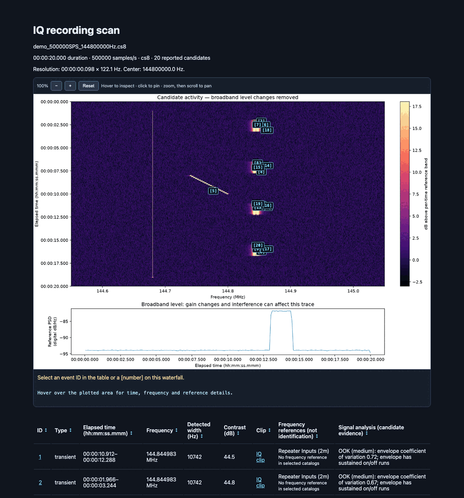
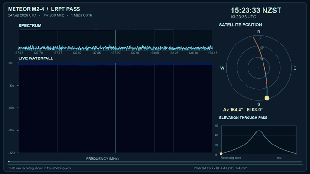

<div align="center">

<h1>📡 iqscan 🔍</h1>

### Find the signals hiding in an IQ recording.

Point it at a raw capture. Get back an interactive offline report — waterfall,
ranked events, zoomed spectrograms, and bit-exact IQ clips ready for inspectrum.

<p>


</p>
<p>


<a href="LICENSE"></a>
<a href="https://github.com/gdamdam/iqscan/actions/workflows/tests.yml"></a>
</p>

</div>

---

## 🧭 Contents

[Quick start](#-quick-start) · [Install](#-install) · [What you get](#-what-you-get) · [Common tasks](#-common-tasks) · [Meteor LRPT](#-meteor-lrpt-images) · [Station catalog](#-station-catalog) · [Caveats](#-before-interpreting-or-sharing-results) · [Learn more](#-learn-more)

---

## ⚡ Quick start

```sh
git clone https://github.com/gdamdam/iqscan.git
cd iqscan
./scan.sh /path/to/capture.cs8 --sample-rate 500000 --center-frequency 137900000 --open
```

- Replace the path, sample rate, and center frequency with your recording's values.
- The launcher creates `.venv` and installs dependencies on first use.
- The report is saved under `scans/` and opened in your browser.
- Your recording is never modified.

> [!IMPORTANT]
> **Use the saved sample rate after decimation**, not the receiver input rate.

Metadata can also come from:

- a SigMF or WAV header (including the SDR#/HDSDR `auxi` center frequency)
- the filename, e.g. `capture_500000SPS_137900000Hz.cs8` or `HDSDR_137900kHz_RF.wav`

---

## 📦 Install

| Platform | How |
|---|---|
| macOS / Linux | `./scan.sh` from the checkout (sets itself up on first run) |
| Windows | `scan.cmd` with the same arguments |
| Anywhere, as a command | `python3 -m pip install .` then `iqscan …` |

**Requirements:** Python 3.9+. NumPy, SciPy and Matplotlib install automatically.

**Optional tools:**

| Tool | Used for |
|---|---|
| [inspectrum](https://github.com/miek/inspectrum) | Opening exported clips |
| [SatDump](https://github.com/SatDump/SatDump) | Meteor LRPT decoding |
| `ffmpeg` | Meteor pass video |

> [!NOTE]
> inspectrum has no official Windows build. Open clips with their `.sigmf-meta`
> in a SigMF-aware viewer such as IQEngine, or use WSL.

---

## 🖼 What you get

| Output | Purpose |
|---|---|
| `report.html` | Browse the waterfall, select events, and zoom into signals |
| `events.json` / `events.csv` | Inspect or process the detection results |
| `clips/` | Exact excerpts of the original recording |
| `OPEN-CLIPS.txt` | Commands to open clips in inspectrum |

Keep the report folder together; the HTML uses images and files beside it.

<p align="center">

<br><sub>Report for a synthetic 20 s, 500 kS/s recording with FSK bursts, a chirp, a steady carrier and a broadband burst.</sub>
</p>

---

## 🎛 Common tasks

Add these options to your scan command:

| Task | Options |
|---|---|
| Inspect possible modulation and supported protocols | `--analyze-signals` |
| Scan only part of a recording | `--start 30 --duration 15` |
| Keep a wideband signal out of the level reference | `--reference-band 0.05 0.15` |
| Change waterfall colors | `--waterfall-style magma` or `--waterfall-style youssef` |
| Export filtered, centered channels | `--channel-clips 3` |
| Add satellite frequency hints | `--sat` |
| Remove generated absolute paths for sharing | `--portable --clips 0` |
| Save a spectrum for later adjustments | `--save-spectrum` |

See all options with `./scan.sh --help`.

### Retune a cached scan

```sh
./scan.sh --redetect scans/YOUR_SCAN --threshold 9
./scan.sh --serve --open
```

The browser explorer previews changes. Run its printed command to save a new report.

### Waterfall styles

| Style | Look |
|---|---|
| `magma` (default) | The existing report colors |
| `youssef` | SatDump's Classic waterfall palette, credited to Youssef Touil |
| `default` | Meteor video only: keeps its existing video palette |

The style is saved with the spectrum and inherited by redetection unless overridden.
Meteor video accepts the same styles. The Youssef colors follow SatDump's
[Classic palette definition](https://github.com/SatDump/SatDump/blob/master/resources/waterfall/classic.json)
and [colormap implementation](https://github.com/SatDump/SatDump/blob/master/src-core/common/colormaps.cpp).

---

## 🛰 Meteor LRPT images

Decode Meteor M2-3 or M2-4 LRPT channel images and telemetry from a stopped
CS16 recording using SatDump's offline pipeline:

```sh
./scan.sh meteor /path/to/recording_2000000SPS_137500000Hz.cs16 \
  --satellite M2-4 --frequency 137900000 --video
```

The new result folder contains:

| Item | Contents |
|---|---|
| `images/` | Decoded channel images |
| `satdump/` | SatDump's recovered data |
| `extraction.json` + decoder log | Run summary and diagnostics |
| video + poster | Scrolling waterfall (with `--video`, needs `ffmpeg`) |

- Both SatDump 1.x stable and 2.x CLI forms are supported.
- The video **predicts** the satellite track from nextpass's observer location and
  cached orbital elements; it does not measure pointing from the IQ.

<p align="center">

<br><sub><b>Simulation:</b> the waterfall is synthetic; the sky track is a real M2-4 prediction for a neutral example location (Wellington, NZ).</sub>
</p>

More in [Meteor extraction](docs/guide.md#meteor-lrpt-image-extraction).

---

## 📻 Station catalog

WWV/WWVH time-station and Meteor frequency references are built in and work offline.
Download or refresh the broader EiBi shortwave/utility catalog with:

```sh
iqscan --update-references
```

Then scan normally: saved stations are matched automatically, no custom JSON needed.

| Option | Effect |
|---|---|
| `--offline-references` | Use local data only; never download |
| `--known-signals eibi` | Also fetch the EiBi schedule on a first scan |

- Failed updates keep the last usable catalog.
- Matches are frequency hints, not confirmed station identities or broadcast-time checks.
- EiBi data is for non-commercial use.

See the [reference guide](docs/guide.md#band-plans-and-known-signal-hints-downloaded-cached-matched-locally).

---

## 🔎 Before interpreting or sharing results

- Detections are candidates. Interference and receiver artifacts can appear as signals.
- Frequency matches are hints; they do not identify a transmitter. Contrast is not calibrated SNR.
- Reports normally contain local paths and recording metadata. Even with `--portable`, review filenames and metadata before sharing.
- Band plans download automatically when the center frequency is known. Use `--offline-references` to prevent catalog downloads; IQ data stays local.

---

## 📚 Learn more

- [Formats and input metadata](docs/guide.md#what-goes-in)
- [Analysis, exports, and cached scans](docs/guide.md#everyday-commands)
- [How detection works](docs/guide.md#how-detection-actually-works--and-where-it-lies-to-you)
- [Reference catalogs](docs/guide.md#band-plans-and-known-signal-hints-downloaded-cached-matched-locally)
- [Pip installation](docs/guide.md#quickstart) · [Tests](docs/guide.md#validation) · [Changelog](CHANGELOG.md)

Use [nextpass](https://github.com/gdamdam/nextpass) to plan a satellite recording.

---

## 📄 License

[GPL-3.0-only](LICENSE)
